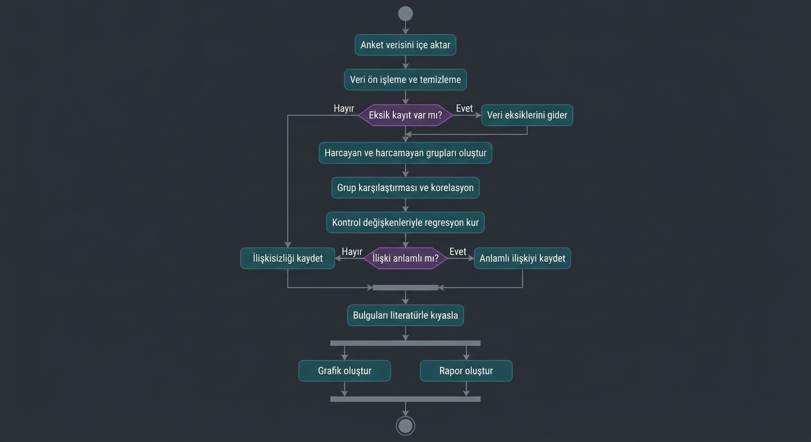
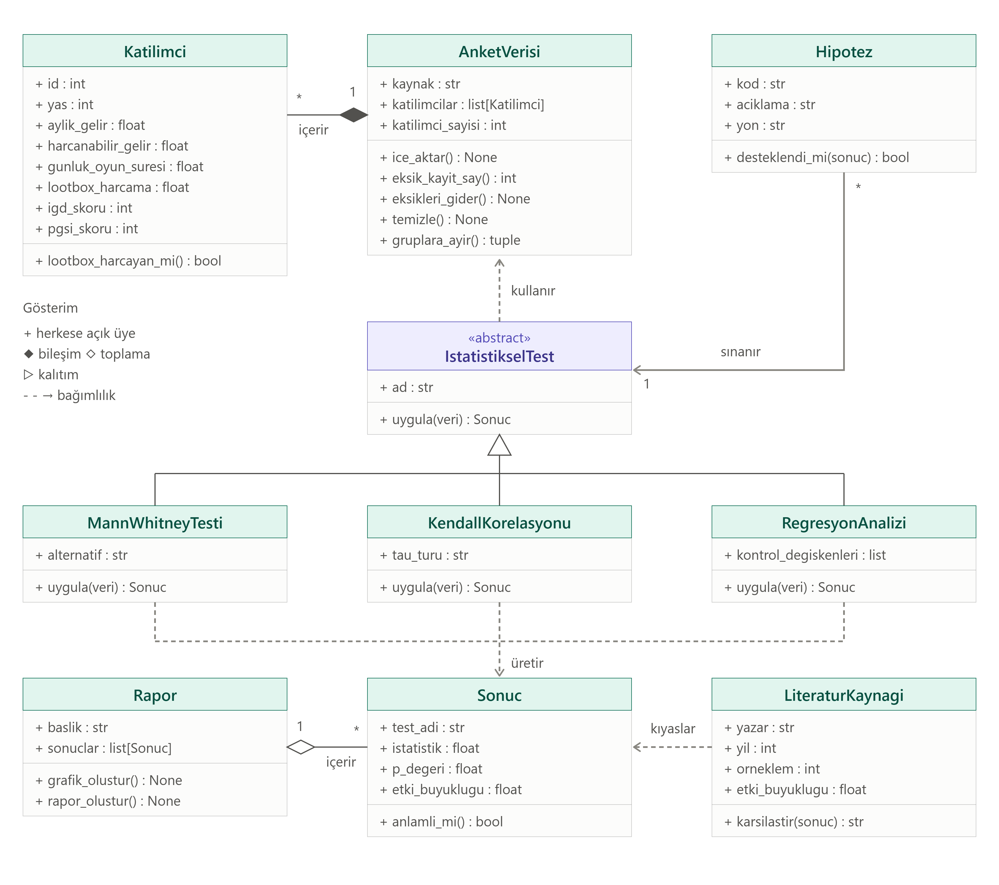

# Loot Box Harcaması ve Oynanış Süresi İlişkisi

Bu proje, dijital oyunlardaki **loot box** (rastgele ödül kutusu) harcaması ile oyuncuların **günlük oynanış süresi** ve **aşırı oyun belirtileri** arasındaki ilişkiyi incelemektedir. Çalışmada yeni veri toplanmaz; daha önce yayımlanmış bir anket verisi Python ile ikincil analize tabi tutulur ve bulgular literatürdeki çalışmalarla kıyaslanır.

> Proje devam etmektedir. Bu aşamada kodlamaya geçmeden önce sistemin yapısı UML diyagramlarıyla modellenmiştir.

## Araştırma soruları ve hipotezler

| Kod | Hipotez |
|---|---|
| H1 | Loot box'a para harcayan oyuncuların günlük oyun süresi, harcamayanlardan yüksektir. |
| H2 | Loot box harcaması ile günlük oyun süresi arasında pozitif bir ilişki vardır. |
| H3 | Bu ilişki, yaş, gelir ve aşırı oyun skoru kontrol edildiğinde de sürer. |
| H4 | Loot box harcaması ile problemli kumar skoru arasında pozitif ilişki vardır. |
| H5 | Loot box harcaması ile aşırı oyun skoru arasında pozitif ilişki vardır. |

H1–H3 projenin yeni katkısıdır (oynanış süresi); H4–H5 ise bulgularımızın literatürle kıyaslanmasını sağlar.

## Veri kaynağı

Etchells, Morgan ve Quintana (2022) tarafından toplanan ve OSF'de açık erişime sunulan anket verisi kullanılmaktadır (2.728 oyuncu, 51 ülke).

- OSF: https://osf.io/2zhrm
- DOI: 10.17605/OSF.IO/2ZHRM

OSF sayfasında veri için bir lisans belirtilmediğinden ham veri bu depoda paylaşılmamıştır. Veriye yukarıdaki bağlantıdan ulaşılabilir.

## Literatür

- **Etchells, P. J., Morgan, A. L. ve Quintana, D. S. (2022).** Loot box spending is associated with problem gambling but not mental wellbeing. *Royal Society Open Science, 9*(8), 220111. https://doi.org/10.1098/rsos.220111
  Loot box harcamasının problemli kumar ve aşırı oyun belirtileriyle ilişkili olduğunu, ruhsal iyi oluş ve psikolojik sıkıntıyla ilişkili olmadığını bulmuştur. Projenin ana veri kaynağıdır.
- **Zendle, D. ve Cairns, P. (2018).** Video game loot boxes are linked to problem gambling: Results of a large-scale survey. *PLOS ONE, 13*(11), e0206767. https://doi.org/10.1371/journal.pone.0206767
  7.422 oyunculuk bir anketle loot box harcaması ile problemli kumar arasındaki ilişkiyi göstermiştir.
- **Zendle, D. ve Cairns, P. (2019).** Loot boxes are again linked to problem gambling: Results of a replication study. *PLOS ONE, 14*(3), e0213194. https://doi.org/10.1371/journal.pone.0213194
  1.172 oyunculuk bir replikasyon çalışmasıyla aynı ilişkiyi yeniden bulmuştur.
- **Drummond, A., Sauer, J. D., Ferguson, C. J. ve Hall, L. C. (2020).** The relationship between problem gambling, excessive gaming, psychological distress and spending on loot boxes in Aotearoa New Zealand, Australia, and the United States: A cross-national survey. *PLOS ONE, 15*(3), e0230378. https://doi.org/10.1371/journal.pone.0230378
  1.049 katılımcıyla, problemli kumar belirtisi olan oyuncuların loot box'lara daha fazla harcama yaptığını bulmuştur.
- **Garea, S. S., Drummond, A., Sauer, J. D., Hall, L. C. ve Williams, M. N. (2021).** Meta-analysis of the relationship between problem gambling, excessive gaming and loot box spending. *International Gambling Studies, 21*(3), 460-479.
  Problemli kumar, aşırı oyun ve loot box harcaması arasındaki ilişkiyi meta-analizle incelemiştir.

## UML diyagramları

### 1. Use Case Diyagramı (Kullanım Durumu)


Diyagram, araştırma veri analiz sisteminin kullanıcılarını ve işlemlerini gösterir. Araştırmacı verinin içe aktarılması, temizlenmesi, ilişki analizi, literatürle kıyaslama ve raporlama işlemlerini yürütür; sonuçlara erişen kişi (öğretim üyesi) ise rapor ve GitHub deposunu inceler. Harici anket veritabanı (OSF) ve yayımlanmış çalışmalar sisteme veri ve karşılaştırma bulgusu sağlayan dış aktörlerdir.

### 2. Activity Diyagramı (Etkinlik)



Diyagram, analizin akışını anket verisinin içe aktarılmasından rapor oluşturmaya kadar gösterir. İki karar noktası vardır: veride eksik kayıt olup olmadığı ve ilişkinin anlamlı çıkıp çıkmadığı. Grafik ve rapor oluşturma işlemleri paralel yürür.

### 3. Class Diyagramı (Sınıf)



Diyagram, projenin temel sınıflarını veri ve analiz olarak iki katmanda gösterir: `Katilimci` ve `AnketVerisi` veriyi, `Hipotez`, `IstatistikselTest` (Mann-Whitney U, Kendall, regresyon alt sınıflarıyla), `Sonuc`, `LiteraturKaynagi` ve `Rapor` ise analiz sürecini temsil eder. Sınıflar bileşim, kalıtım, toplama ve bağımlılık ilişkileriyle bağlanmıştır.

## Klasör yapısı

```
.
├── README.md
└── docs/
    └── diagrams/
        ├── 01_use_case_diyagrami.png
        ├── 02_activity_diyagrami.png
        └── 03_class_diyagrami.png
```
